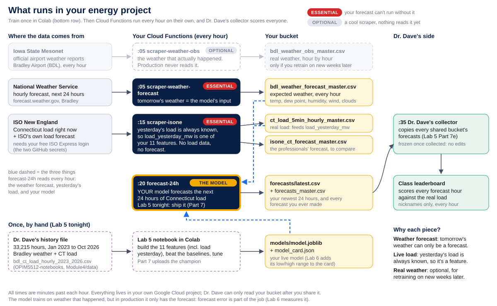

# energy-forecasting

Hourly weather + electricity-load pipeline on Google Cloud, and a model that forecasts **Connecticut's electricity load
for the next 24 hours, every hour**. Built for Dr. Dave Wanik's courses at UConn (OPIM 5512 Applied Data Science, Lab 5
onward). Every student forks this repo into their **own** energy project on Google Cloud.

## How it fits together



Train once in Colab on Dr. Dave's history file (Bradley weather + Connecticut load, January 2023 to October 2026), upload the model, and from then on four Cloud Functions in your own project run every hour without you.

## What runs every hour (Eastern time)

| Minute | Cloud Function | Source | Writes to `gs://<bucket>/energy/` |
|---|---|---|---|
| :05 | `scraper-weather-obs` | Iowa State Mesonet, Bradley Airport (BDL) reports | `datasets/bdl_weather_obs_master.csv` (one row per UTC hour) |
| :05 | `scraper-weather-forecast` | [forecast.weather.gov](https://forecast.weather.gov/MapClick.php?lat=41.9389&lon=-72.6832&FcstType=digital), Bradley | `datasets/bdl_weather_forecast_master.csv` (every snapshot: this hour + the next 24, with the NWS issue time) |
| :15 | `scraper-isone` | ISO New England web services, Connecticut zone (4004) | `datasets/ct_load_hourly_master.csv` (official metered, ~2.5 days late), `datasets/ct_load_5min_hourly_master.csv` (live, averaged per hour), `datasets/isone_ct_forecast_master.csv` (ISO-NE's own forecast) |
| :20 | `forecast-24h` | your model in `models/model.joblib` | `forecasts/latest.csv` (24 rows: `target_hour_utc`, `predicted_low_mw`, `predicted_load_mw`, `predicted_high_mw`), `forecasts/history/`, `datasets/forecasts_master.csv` |

Raw downloads are kept in `energy/raw/`. All times are stored in **UTC** (`*_utc` columns = the hour the value begins),
so daylight saving never duplicates or drops a row.

## Set up (once)
Follow the **[Energy Project Setup Guide](https://github.com/drdave-teaching/OPIM5512-notebooks/blob/main/Module4/Energy_Project_Setup_F26.ipynb)**:
new Google Cloud project, fork this repo, Workload Identity Federation, 6 repository **variables**
(`PROJECT_ID`, `REGION`, `BUCKET_NAME`, `RUNTIME_SA`, `DEPLOYER_SA`, `WORKLOAD_IDENTITY_PROVIDER`) and 2 repository
**secrets** from your own free ISO Express account (`ISO_NE_USERNAME`, `ISO_NE_PASSWORD`). Without the secrets,
`scraper-isone` deploys but reports `"status": "skipped"`.

Each folder in `cloud_function/` deploys with its own workflow in `.github/workflows/` (on a push to `main` that changes
it, or **Actions → Run workflow**). Get course updates with **Sync fork → Update branch**.

## Train and ship a model
**[Lab 5 notebook](https://github.com/drdave-teaching/OPIM5512-notebooks/blob/main/Module4/Lab5_Energy_Forecast_In_Production.ipynb)**:
Bradley weather + Connecticut load from Jan 2023 to Oct 2026 ([how it was built](https://github.com/drdave-teaching/OPIM5512-notebooks/blob/main/Module4/Lab5_Building_the_Training_Data.ipynb)),
baselines, time-series cross-validation, a tuned model, then upload to `energy/models/model.joblib`.
`forecast-24h` builds its inputs with the same `make_features` function as the notebook, so any scikit-learn model
trained on those 11 features works.

**Just want a working model right now?** In Cloud Shell, from your fork:
```bash
python3 -m venv ~/energy-venv && ~/energy-venv/bin/pip install -q -r starter/requirements.txt
~/energy-venv/bin/python starter/train_and_ship.py --project YOUR-ENERGY-PROJECT-ID --bucket YOUR-BUCKET
gcloud scheduler jobs run forecast-24h-hourly --location=us-central1
```
It trains gradient boosting with the Lab 5 champion settings (about 120 MW average error on 2026, vs 266 MW for "same hour
yesterday") plus an 80% range (77% of 2026 hours landed inside it), and uploads both; your next 24 hours appear in
`energy/forecasts/latest.csv`. Add `--no-range` for the expected value only.

## Low, expected and high (Lab 6)
Every forecast hour can carry an **80% range**: `predicted_low_mw` (10th percentile) and `predicted_high_mw` (90th).
`forecast-24h` reads how to build it from your `model_card.json`:

| `"range_method"` in the card | Also upload | What `forecast-24h` does |
|---|---|---|
| `"quantile_models"` | `models/model_low.joblib`, `models/model_high.joblib` (any model with `.predict` on the same 11 features, e.g. quantile boosting or a quantile forest) | low = `model_low.predict(X)`, high = `model_high.predict(X)` |
| `"offsets_by_hour"` | nothing: `"range_offsets_mw": {"low": [24 MW], "high": [24 MW]}` in the card, one per Connecticut hour (0 = midnight) | low = expected + low offset, high = expected + high offset |
| missing (Lab 5 cards) | nothing | expected value only; the low and high columns stay empty |

`"range_widen": 1.3` (optional) stretches either range 30% around the expected value, so you can fix a range that the
leaderboard shows is too narrow without retraining. The expected value always stays inside its range, and a broken range
never stops the expected-value forecast (the run reports `"range_method": "error"` and why).

## Data credits
Weather: Iowa State Mesonet (mesonet.agron.iastate.edu) and the National Weather Service. Load and forecasts: ISO New
England (iso-ne.com, ISO Express web services). Each student uses their own ISO Express account.
